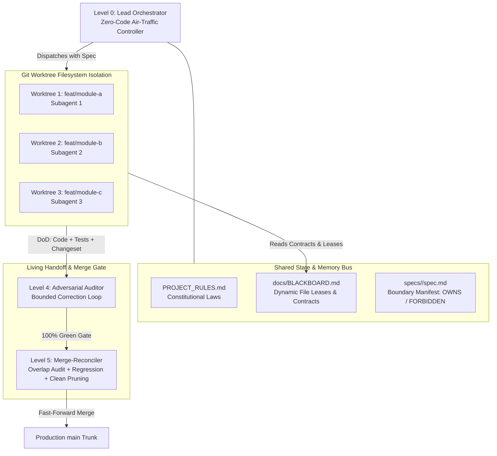

<p align="center">
  <h1 align="center">⚡ Vibe Swarm Harness</h1>
  <p align="center">
    <strong>Stop Vibe Coding in Chaos. Start Engineering with Spec-Driven Multi-Agent Swarms.</strong>
  </p>
  <p align="center">
    A production framework for running 5–10 parallel AI coding agents using Git Worktrees, strict file boundaries, tiered model allocation, and living markdown contracts — with zero merge conflicts.
  </p>
</p>

<p align="center">
  <a href="https://github.com/Aashu-destined/vibe-swarm-harness/stargazers"></a>
  <a href="https://github.com/Aashu-destined/vibe-swarm-harness/network/members"></a>
  <a href="LICENSE"></a>
  
  
</p>

---

## ⚡ The Problem: Why Vibe Coding Collapses

Single-agent "vibe coding" feels like magic until you scale to real-world codebases or parallel workflows:
1. **The Shared-Directory Race Condition:** Running 3 agents in the same repository folder while switching branches via `git checkout` clobbers files mid-write, locks file handles, and crashes the session.
2. **Context Rot & "Lost-in-the-Middle":** As chat history balloons past 50k tokens, the agent's adherence to negative constraints (*"Do NOT touch file X"*) drops by up to 40%.
3. **Merge Apocalypse:** When uncoordinated agents modify overlapping dependency files (`package.json`, shared configs, core models), merging their PRs results in 100+ intractable conflicts.
4. **Chat-Loop Waste:** Unstructured inter-agent chatter burns token budgets rapidly without making measurable code progress.

**Vibe Swarm Harness** solves this by transforming Markdown files from static documentation into a **Deterministic Inter-Process Communication (IPC) Protocol, Shared Memory Bus, and File-Locking Operating System.**

---

## 🏗️ Repository Layout

```text
vibe-swarm-harness/
├── .github/
│   ├── workflows/
│   │   └── validate-specs.yml       # Automated Markdownlint & Broken Link CI
│   └── pull_request_template.md     # Subagent 4-point Living Handoff checklist
├── bin/                             # Production Swarm Automation CLI Scripts
│   ├── agent-spawn.sh               # Spawns isolated Git worktree + dedicated branch
│   ├── blackboard-sync.sh           # Queries live file leases and contract broadcasts
│   └── reconcile-merge.sh           # Gatekeeper overlap audit, merge, & worktree cleanup
├── templates/                       # Copy-pasteable Project Boilerplates
│   ├── AGENTS.template.md           # 6-Tier Model Mapping + Token Boundaries
│   ├── CONSTITUTION.template.md     # Non-negotiable laws & negative constraints
│   ├── BLACKBOARD.template.md       # Shared state bus & dynamic file locks
│   ├── SPEC.template.md             # Boundary Manifest (OWNS / READS / FORBIDDEN)
│   └── CHANGESET.template.md        # Standardized subagent handoff report
├── docs/
│   ├── ARCHITECTURE.md              # Deep system topology & Mermaid diagrams
│   ├── TOKEN_ECONOMY.md             # Context budgeting & anti-rot guidelines
│   ├── BLACKBOARD.md                # Live shared state bus (Active leases & locks)
│   ├── BRANCH_AUDIT_LOG.md          # Gatekeeper reconciliation records
│   └── changesets/                  # Ephemeral micro-changeset snippets directory
├── AGENTS.md                        # Active 6-Tier Agent Roster & Model Assignments
├── PROJECT_RULES.md                 # Constitutional project laws (< 200 lines)
├── CHANGELOG.md                     # Consolidated release log
└── README.md                        # Production Documentation & Quickstart
```

---

## 🛰️ Multi-Agent Swarm Topology



---

## 🤖 6-Tier Agent Hierarchy & Model Deployment Matrix

| Level | Role / Layer | Industry Best (Ideal) | Active Gemini Stack Deployment | Rationale / Logic |
|:---|:---|:---|:---|:---|
| **Level 0** | **Lead Orchestrator** | Claude 3.7 Sonnet (Thinking) | **`gemini-4-argon`** *(Fallback: `gemini-2.5-pro`)* | Executive multi-agent tool dispatch, task decomposition, and global blackboard state synchronization without injecting parent code bloat into the main session. |
| **Level 1** | **Main Branch Swarm** | Claude 3.7 / OpenAI o3-mini | **`gemini-2.5-pro`** (Nano Banana Pro) | System-level architectural foundations, core schema contracts, invariant mathematical logic, and zero-hallucination type generation. |
| **Level 2** | **Feature Branch Teams** | Claude 3.5 Sonnet | **`gemini-4-argon`** (`reasoning_effort: medium`) | High-throughput architectural coding, type safety, modular feature builds, state wiring, and external API integrations. |
| **Level 3** | **Sub-Branch Workers** | Claude 3.5 Haiku / GPT-4o-mini | **`gemini-3.8-flash`** *(or `gemini-2.5-flash`)* | 200+ t/s micro-generation for bounded algorithms, parsing routines, isolated helper functions, and high-speed single-file implementations. |
| **Level 4** | **Branch Auditors** | DeepSeek-R1 / Claude 3.7 | **`gemini-2.5-flash-thinking`** | Deep Chain-of-Thought (CoT) adversarial test fuzzing, edge-case generation, zero-confirmation-bias code inspection, and Living Handoff DoD verification. |
| **Level 5** | **Merge-Reconciler** | Claude 3.5 Sonnet | **`gemini-4-argon`** | Impartial neutral third-party arbiter for AST-safe merge conflict resolution, full regression test execution, documentation consolidation, and worktree pruning. |

---

## 🛡️ The 5 Core Pillars of Swarm Engineering

### 1. Hardware Isolation via Git Worktrees
Never switch branches in the same folder while agents are running. Subagents work in dedicated physical directories outside the main repository tree (`../trees/agent-<branch>`), sharing the same `.git` database:
```bash
./bin/agent-spawn.sh SA-B1-01 feat/auth-service
```
Zero file handle collisions, zero I/O locks, concurrent package builds.

### 2. The Blackboard Pattern (`docs/BLACKBOARD.md`)
Subagents do not communicate via conversational chat loops. Subagents coordinate asynchronously through the **Blackboard**:
* **Lock Before Write:** Subagents register exclusive file leases before writing.
* **Contract Broadcasts:** Breaking changes are announced on the Blackboard so sibling workers pull updates before consuming APIs.

### 3. Boundary Manifests (Zero Merge Conflicts)
Every feature spec defines:
* **`OWNS` (Read/Write):** Exclusive target directories.
* **`READS` (Read-Only):** Shared contracts and schemas.
* **`FORBIDDEN` (Restricted):** Sibling modules and root dependency manifests (`package.json`, `Cargo.toml`).

### 4. Living Handoff & Bounded Correction Loop
A subagent cannot claim completion merely by writing code. Every commit requires:
1. **Code** within declared boundaries.
2. **Passing Automated Tests** (100% green).
3. **Spec Tasks Checkbox Ticked** (`[x]`).
4. **Changeset Snippet** in `docs/changesets/`.

> **The Bounded Correction Loop:** If a test or changeset is missing, the task is **never destroyed**. The auditor issues an actionable deficiency ticket, keeping the lease in `CORRECTION_PENDING` with up to 3 bounded correction retries.

### 5. The Neutral Merge-Reconciler Gatekeeper
Implementing subagents never merge into `main` directly. A dedicated Gatekeeper executes:
1. Overlap Audit (Manifest vs Diff)
2. Contract Verification
3. Full Regression Suite
4. Changelog Consolidation
5. Worktree Pruning:
```bash
./bin/reconcile-merge.sh feat/auth-service SA-B1-01
```

---

## 🚀 Quickstart

### 1. Clone the Harness
```bash
git clone https://github.com/Aashu-destined/vibe-swarm-harness.git my-project
cd my-project
```

### 2. Configure Your Agent Models
Edit `AGENTS.md` and set your preferred model engines or pin via CLI:
```bash
hermes config set delegation.model gemini-4-argon
hermes config set delegation.reasoning_effort medium
```

### 3. Spawn Parallel Worktrees
```bash
chmod +x bin/*.sh
./bin/agent-spawn.sh SA-B1-01 feat/core-engine
./bin/agent-spawn.sh SA-B2-01 feat/api-gateway
```

### 4. Reconcile & Merge
```bash
./bin/reconcile-merge.sh feat/core-engine SA-B1-01
```

---

## 🧠 Token Economy: Anti-Rot Boundaries

To prevent token exhaustion and model degradation:
* **Level 0 (Orchestrator):** `< 80k` tokens with periodic `/compact`.
* **Level 1 & 2 (Feature Teams):** `< 40k` tokens per run.
* **Level 3 (Micro-Workers):** `< 15k` tokens with immediate exit.
* **Level 4 & 5 (Auditors & Reconcilers):** Ephemeral execution; zero long-term chat retention.

See [`docs/TOKEN_ECONOMY.md`](docs/TOKEN_ECONOMY.md) for full benchmarks.

---

## 📜 License
Distributed under the MIT License. See [`LICENSE`](LICENSE) for details.

Developed with precision by [Cyclolysis Aashu (Aashu-destined)](https://github.com/Aashu-destined).
