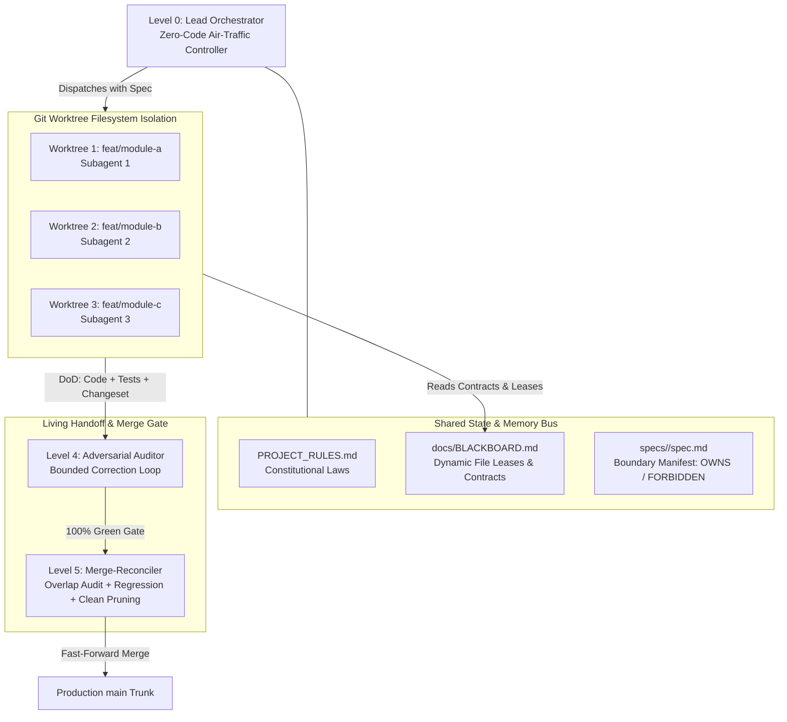

# Architecture & Multi-Agent Swarm Design

## 1. Executive Overview
**Vibe Swarm Harness** converts stochastic, chaotic vibe coding into a deterministic, high-throughput agentic engineering pipeline. 

Instead of treating AI models as chat participants who overwrite each other's work and trigger massive merge conflicts, the system treats them as **specialized, isolated compute nodes** governed by strict filesystem boundaries, shared memory buses, and automated gatekeepers.

---

## 2. Swarm Topology & Information Flow

---

## 3. The 3 Zero-Conflict Engineering Pillars

### Pillar I: Git Worktree Hardware Isolation
* **Failure Mode:** Running multiple agents in the same working tree while executing `git checkout` causes catastrophic file lock race conditions.
* **The Fix:** Every agent operates in a dedicated physical directory outside the repository (`../trees/agent-<branch>`). They share the same underlying `.git` object store, ensuring concurrent builds and zero checkout collisions.

### Pillar II: The Blackboard Pattern (Shared State Bus)
* **Failure Mode:** Peer-to-peer agent conversational chat creates endless token loops and context rot.
* **The Fix:** Agents coordinate asynchronously via `docs/BLACKBOARD.md`. Before modifying any file glob, an agent claims an exclusive lease. If another agent holds the lock, sibling agents wait or pivot.

### Pillar III: Boundary Manifests & Living Handoff
* **Failure Mode:** Agents modifying unassigned root files (`package.json`, global configs) or touching sibling modules.
* **The Fix:** Every feature spec defines `OWNS`, `READS`, and `FORBIDDEN` file sets. Any violation results in immediate rejection. Tasks exit only when accompanied by passing tests, updated task checklists, and a micro-changeset snippet.
